# 🐰 Raspberry Pi Game Computer + Peter Rabbit Hide & Seek

A kid built his own tiny touchscreen computer from a **Raspberry Pi**, then made a
hide-and-seek game for it **just by talking to AI**. That's called *vibe coding*.

You're alone in a big garden. Peter Rabbit is hiding somewhere among the crops. Find him
before night falls, get close, and press **E** to catch him. Every round he runs faster and
hides somewhere trickier.

### 🎮 [Play it in your browser](https://littlevibecoders.github.io/raspberry-pi-peter-rabbit-game/) · 📺 [Watch the video](https://youtu.be/-cgP8JJCQWE)

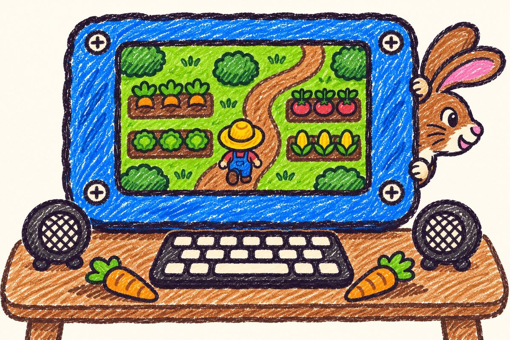

| | |
|---|---|
| ⏱️ Time | 5 seconds to play it · an afternoon to build the computer · 15 minutes to vibe-code your own game |
| 🧒 Age | 8+ with a grown-up helping |
| 💲 Cost | The game is free. The computer is roughly $150–200 if you buy every part new (less if you already have some). |
| 🛠️ Skills | None! No soldering. The parts plug together. |

---

## 📚 Contents

- [What's in the video](#whats-in-the-video)
- [Path A: just play the game](#path-a-just-play-the-game)
- [Path B: build the Raspberry Pi computer](#path-b-build-the-raspberry-pi-computer)
- [Path C: put the game on your Pi](#path-c-put-the-game-on-your-pi)
- [Path D: vibe-code your own game](#path-d-vibe-code-your-own-game-the-fun-way-)
- [How the game works](#how-the-game-works)
- [Troubleshooting](#troubleshooting)
- [For grown-ups](#for-grown-ups)
- [Credits & licence](#credits--licence)

## What's in the video

📺 **[Watch it on YouTube](https://youtu.be/-cgP8JJCQWE)**

1. **The parts.** What a Raspberry Pi is, and every part you need.
2. **Putting it together.** Case, fan, screen, keyboard, speakers, cables.
3. **3D printing a case** for the screen (optional).
4. **Vibe coding.** The kid says the whole game out loud to the AI in one go.
5. **Playing it** on the computer he built.

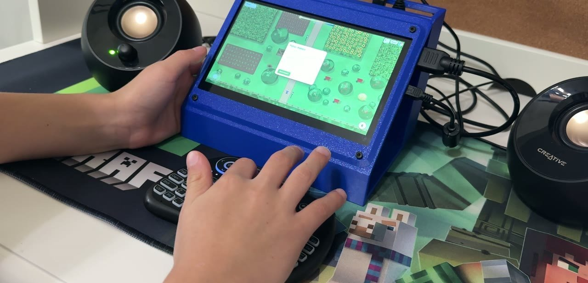

---

## Path A: just play the game

👉 **[Play Peter Rabbit Hide & Seek](https://littlevibecoders.github.io/raspberry-pi-peter-rabbit-game/)**

It works on a computer, tablet or phone. Nothing to install, no sign-up.

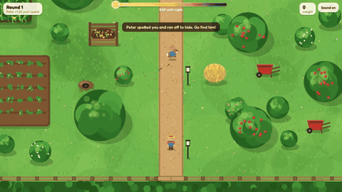

| Do this | Keyboard | Touchscreen |
|---|---|---|
| Walk | **W A S D** or the arrow keys | Joystick, bottom-left |
| Catch Peter | **E** (when it pops up above him) | Big **E** button, bottom-right |
| Sound on/off | **M** | **Sound on** button |
| Next round | **Enter** | Tap the green button |

**How to find Peter:** look for rustling leaves, tiny footprints and the tips of his ears.
With sound on, you can hear the rustle coming from his side. Walking into tall crops or under
a tree lets you see through them.

| Start | Found him! | Caught! |
|---|---|---|
| 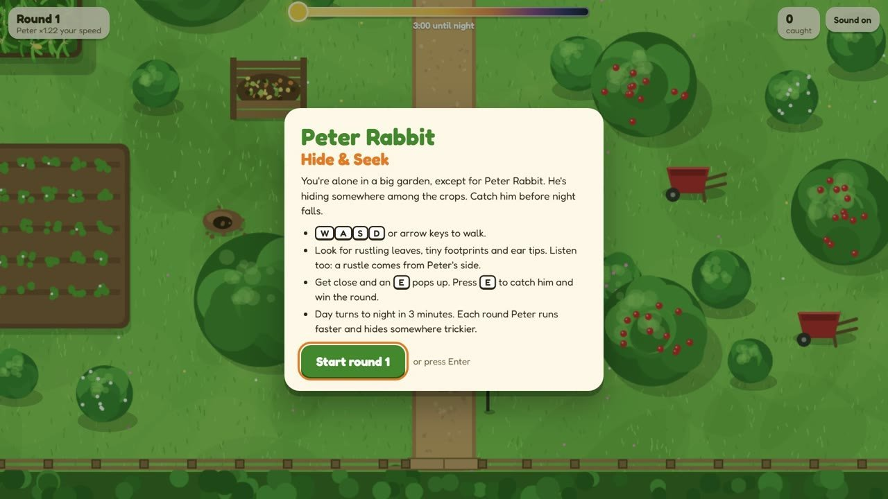 | 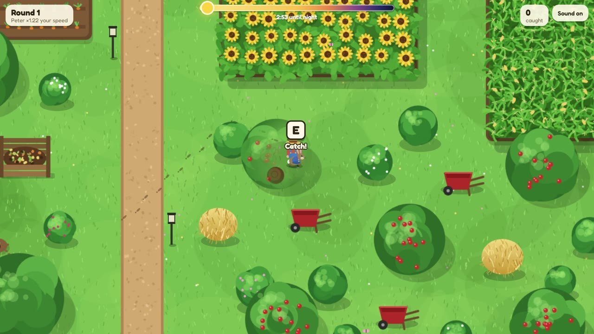 | 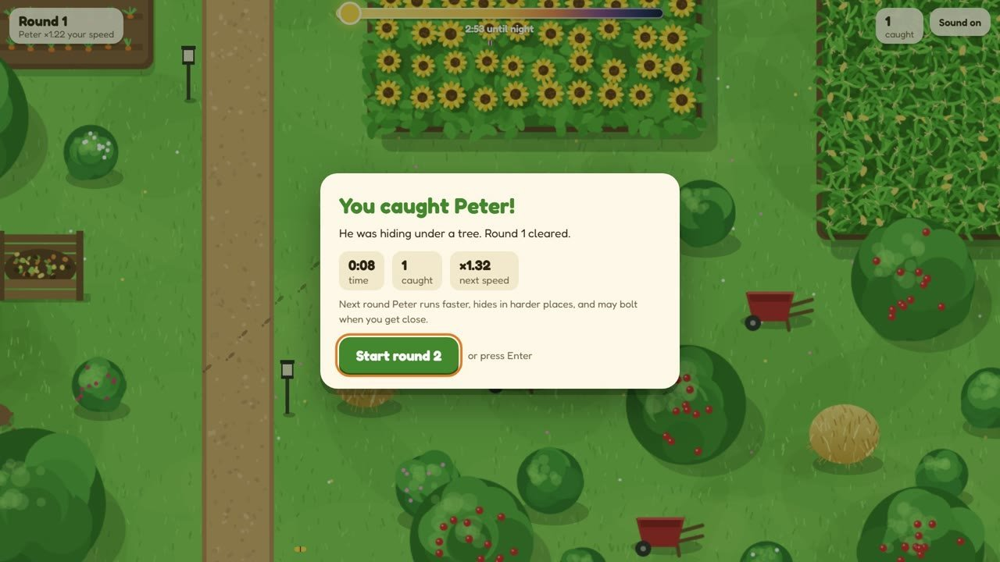 |

| The sky turns golden... | ...then it's night |
|---|---|
| 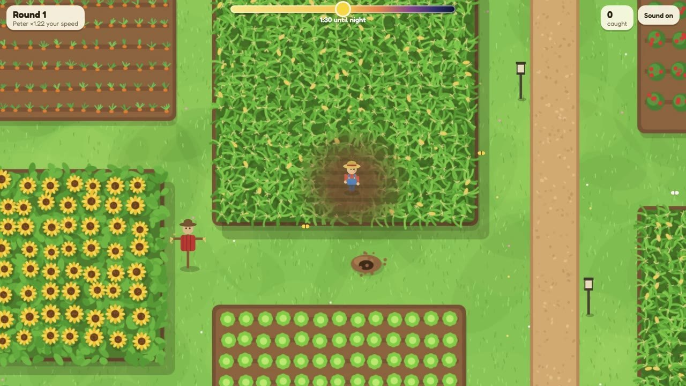 | 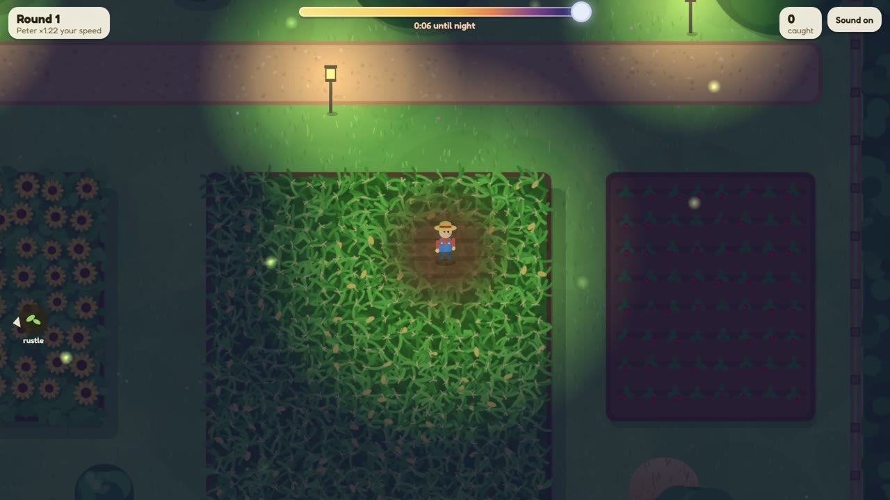 |

---

## Path B: build the Raspberry Pi computer

### What you need

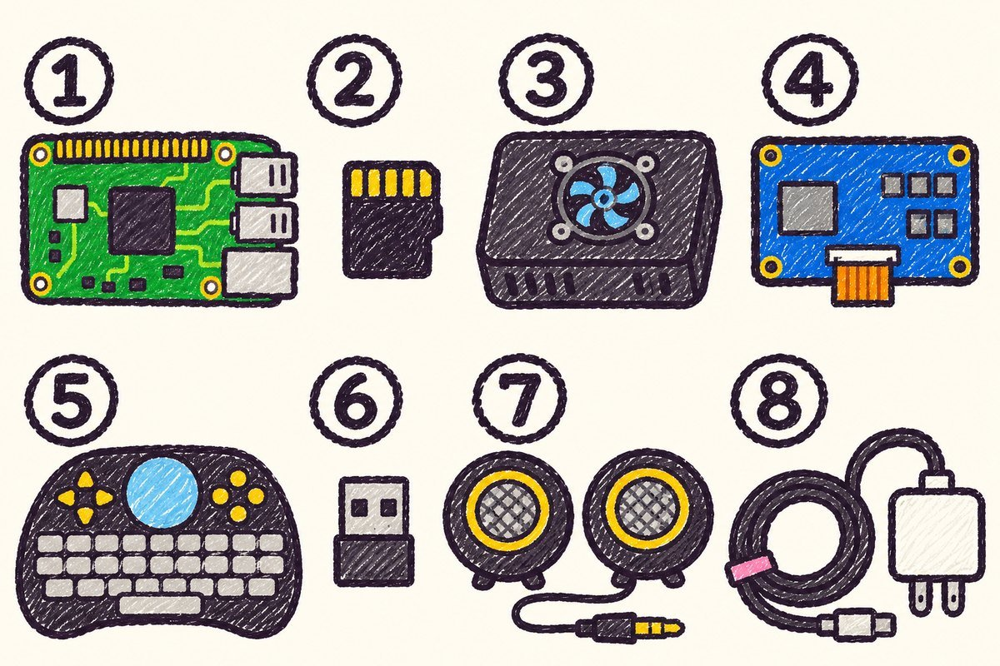

| # | Part | What it does | Where we got it |
|---|---|---|---|
| 1 | **Raspberry Pi 4 Model B** (2 GB or more) | The whole computer, on one tiny board | [raspberrypi.com](https://www.raspberrypi.com/products/raspberry-pi-4-model-b/) (lists official sellers) |
| 2 | **microSD card**, 32 GB or bigger | The Pi's memory: it holds the system and the games | Any brand. A SanDisk or Samsung "A1" card works well. |
| 3 | **iUniker Pi 4 case with fan and heatsinks** | The "helmet" that protects the Pi. The fan keeps it cool. | [Amazon](https://www.amazon.com/dp/B07D3S4KBK) |
| 4 | **Hosyond 7" IPS touchscreen** (1024×600, HDMI) | The screen. You can tap and drag on it. | [Amazon](https://www.amazon.com/dp/B09XKC53NH) |
| 5 | **REIIE H9+ mini wireless keyboard** (backlit) | How you tell the Pi what to do. It has a touchpad too. | [Amazon](https://www.amazon.com/dp/B06X9J8NG4) |
| 6 | The keyboard's **USB dongle** | Comes in the keyboard box. It lets the keyboard talk to the Pi. | (in the box) |
| 7 | **Creative Pebble 2.0 USB speakers** | So the game can make sounds | [Amazon](https://www.amazon.com/dp/B0791H74NT) |
| 8 | **Official Raspberry Pi 4 USB-C power supply** (5.1 V, 3 A) | Power for everything | [raspberrypi.com](https://www.raspberrypi.com/products/type-c-power-supply/) |
| | **Micro-HDMI to HDMI cable** | Carries the picture from the Pi to the screen. The Pi 4 has *micro*-HDMI ports. | Comes in the screen's box |

**Optional, for the blue 3D-printed stand:**

| Part | Notes |
|---|---|
| A 3D printer (or a friend, library or school makerspace that has one) | We used a Bambu Lab printer. Printing took about 8 hours. |
| **PLA filament** | Any colour. We picked blue. |
| **M3×16 screws and nuts** | They hold the screen in the stand. |
| The stand design | 👉 **[Raspberry Pi Standalone 7" Display Case by Mira on MakerWorld](https://makerworld.com/en/models/2643694)**. It's someone else's design, so download it from their page (it isn't included here). It's made for this exact Hosyond screen. |

> These are plain links, not affiliate links. We don't earn anything if you buy.

### How it all plugs together

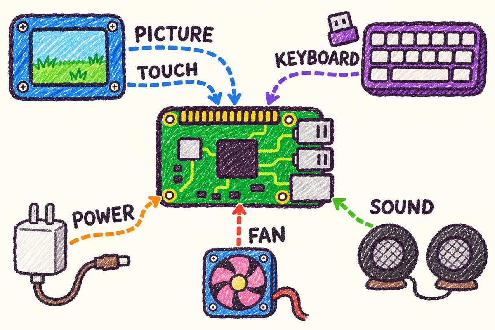

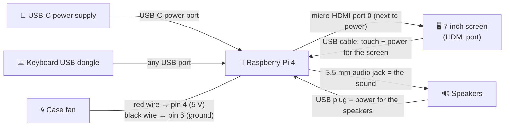

### Step by step

1. **Get the memory card ready (grown-up, on another computer).** Install
   [Raspberry Pi Imager](https://www.raspberrypi.com/software/), choose **Raspberry Pi 4**,
   **Raspberry Pi OS (64-bit)** with desktop, and your microSD card. Click **Edit settings**,
   make up a username and a **strong password** (not the old default `pi` / `raspberry`), and
   add your Wi-Fi. Then write the card.
2. **Heatsinks and case.** Stick the little heatsinks onto the chips, then put the Pi in the
   bottom of the case.
3. **Fan.** Plug the fan's red wire onto **pin 4** and the black wire onto **pin 6** (the
   2nd and 3rd pins from the corner on the outside row). The Pi gives the fan electricity:
   in through one wire, round the fan, back out the other. Snap the lid on.
4. **Memory card.** Slide the microSD card into the slot underneath, contacts facing up
   towards the board.
5. **Screen.** HDMI cable from the screen to the Pi's micro-HDMI port **next to the power
   port**. Then the screen's USB cable to any USB port on the Pi (that's how touch works).
6. **Keyboard.** Plug the tiny USB dongle into a USB port and switch the keyboard on.
7. **Speakers.** USB plug into a USB port (that's their power) and the round audio plug into
   the Pi's headphone jack (that's the sound).
8. **Power last.** Plug in the USB-C power supply. The Pi starts by itself.
9. **Sound check.** If there's no sound, click the **speaker icon** at the top-right of the
   Pi's desktop and pick **Analog** or **Headphones**, not HDMI. The screen has no speakers.
10. *(Optional)* **3D-printed stand.** Print the [MakerWorld design](https://makerworld.com/en/models/2643694),
    screw the screen in with the M3 screws and nuts, and slot the Pi in the back.

---

## Path C: put the game on your Pi

**The quick way:** open Chromium on the Pi, go to the
[game's page](https://littlevibecoders.github.io/raspberry-pi-peter-rabbit-game/) and press
**F11** for full screen. Done!

**The proper way: a desktop icon that works without the internet.** Open the Terminal on
the Pi and type:

```bash
git clone https://github.com/littlevibecoders/raspberry-pi-peter-rabbit-game.git
cd raspberry-pi-peter-rabbit-game
bash pi/install.sh
```

A **Peter Rabbit** icon appears on the desktop (and in the menu under *Games*).
Double-click it to play full screen. To close it, press the **rainbow X** in the top-right
corner, or **Alt+F4**. Your best round is saved on the Pi.

> 🔎 It's good practice to read a script before you run it. [`pi/install.sh`](pi/install.sh)
> is short: it copies the game into a `peter-rabbit` folder in your home folder and makes the
> icon. It doesn't need `sudo` and doesn't download anything.

---

## Path D: vibe-code your own game (the fun way) 🎤

This is the real point of the video. **You don't need to know how to code.** You need to
know what you want, and say it clearly.

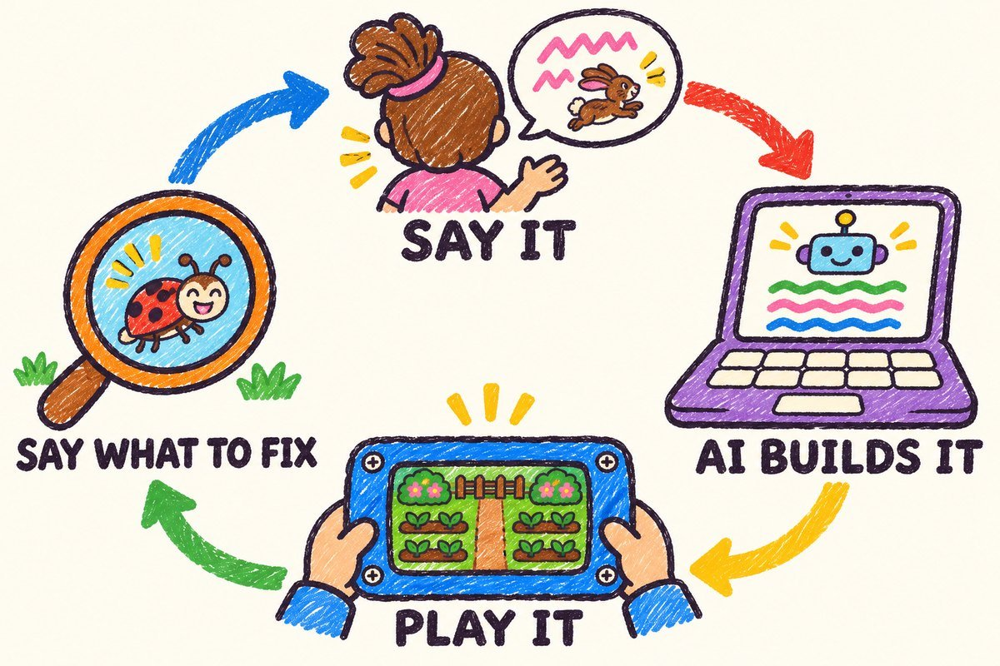

**What we used:**
- **[Claude](https://claude.com/download)** in the Claude desktop app (the *Code* tab,
  which can make files on your computer), with a grown-up's account.
- The app's **microphone button**, so the kid could *say* the prompt instead of typing it.
  Any AI coding assistant that can write files will work.

**What happened:**

1. The kid pressed the microphone and described the whole game in **one long prompt**
   (it's in **[PROMPTS.md](prompts/PROMPTS.md)**).
2. The AI planned and wrote about **1,100 lines of code** in roughly 14 minutes. It hit an
   error, found it and fixed it by itself.
3. It made one HTML file. Open it in any browser and the game runs.
4. Second prompt: *"make the game for my Raspberry Pi, it should play there."* The AI
   made the touchscreen joystick and **E** button work on the Pi's screen, added a rainbow X
   to close the game, made it draw fewer pixels so a small computer stays smooth, and sent
   it to the Pi.

**Why the prompt worked: it gave the AI clues.**

| ❌ Vague | ✅ What the kid actually said |
|---|---|
| "Make a rabbit game" | "You're in a garden and you're the only one there" |
| "Make it hard" | "Peter can run fast, but not that fast, but he can still run faster than you" |
| "Add a timer" | "It's day and it turns night in three minutes. It slowly turns night." |
| "Make levels" | "The next round, Peter's faster and hides in more difficult places" |
| "Add controls" | "If you find him, you can press E. It says E when you can catch him." |

**Ideas to try next:** make Peter hide in a snowy garden, add a second rabbit, let
Mr. McGregor's cat chase *you*, make night come faster, or add a carrot you can throw to
distract Peter. Say it to the AI, play it, then say what to change.

---

## How the game works

Everything is in **one file**: [`docs/index.html`](docs/index.html). No game engine, no
images to load. The AI drew the garden, the rabbit and the farmer with code on an HTML
`<canvas>`, and made the sounds with the browser's Web Audio.

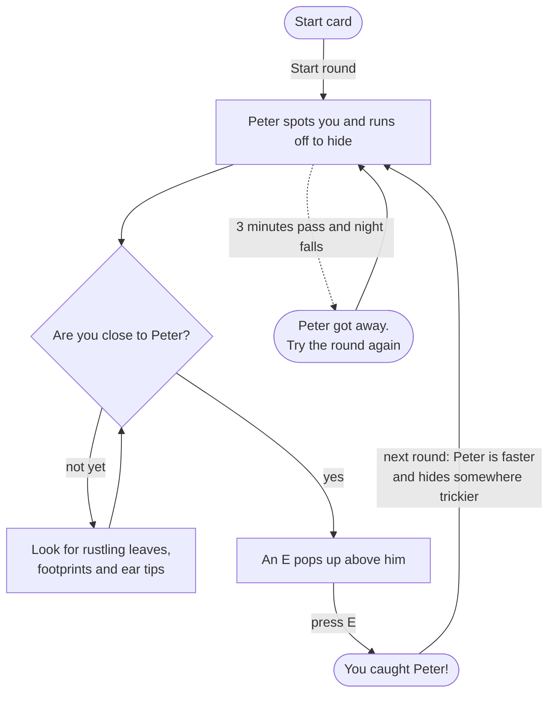

| Thing | How the code does it |
|---|---|
| **Day to night** | A 3-minute timer. The sky colour and darkness depend on how much time has passed. Lanterns and fireflies turn on near the end. |
| **Peter's brain** | He picks a hiding spot (a bush, the corn, a log pile, a burrow...) and finds a path to it around fences and ponds with the *A\** (A-star) path-finding algorithm. |
| **Getting harder** | Each round Peter is 0.1× faster (starting at 1.22× your speed), chooses harder spots, rustles less often, and may bolt to a new spot when you get close. |
| **Saving your best** | Your best round is saved in the browser's own storage on your device. Nothing is sent anywhere. |

---

## Troubleshooting

| Problem | Try this |
|---|---|
| The screen stays black | Check the HDMI cable is in the micro-HDMI port **next to the power port**. |
| Touch doesn't work | The screen's **USB** cable must be plugged into the Pi, not only the HDMI. |
| No sound | Speaker icon (top-right of the Pi desktop) → choose **Analog / Headphones**. Turn the knob on the speaker up. In the game, check it says **Sound on**. |
| The keyboard does nothing | Is the dongle plugged in? Is the switch on the keyboard on? Charge it with its USB cable. |
| The fan doesn't spin | Swap the fan wires onto pins 4 and 6 (red on 4). Some fans only spin when the Pi gets warm. |
| A red lightning bolt shows in the corner | The power supply is too weak. Use the official 5.1 V 3 A one. |
| The game is slow on the Pi | Close other programs and the browser tabs you don't need. |
| `bash pi/install.sh` says Chromium isn't installed | Run `sudo apt install chromium`, then try again. |
| The icon asks "Execute?" when you double-click | Choose **Execute**. |

## For grown-ups

- **Privacy:** the game has no accounts, no ads, no tracking and no internet connections of
  its own. It only loads a font (Fredoka) from Google Fonts; offline, it falls back to a
  built-in font. The best round is kept in the browser's local storage on the device.
- **Security:** the page has a strict Content Security Policy that only allows its own script
  and the font, and blocks every other network request. `pi/install.sh` runs as your normal user, writes only
  inside your home folder and downloads nothing. On the Pi, use your own strong password
  (Raspberry Pi Imager asks for one), keep the system updated
  (`sudo apt update && sudo apt full-upgrade`), and only turn on SSH if you need it.
- **Safety:** everything runs on low-voltage USB power. Help with the power supply and the
  3D printer (the nozzle and bed get very hot).
- **Comments and issues:** please don't post personal information (names, school, location,
  photos of kids).

## Credits & licence

- **Game code:** [MIT License](LICENSE). Made by a 10-year-old by talking to Claude, with a
  grown-up helping.
- **Illustrations** in this README: made with Codex's image generator, in the crayon style
  of the video. Game screenshots are real captures of the game.
- **Font:** [Fredoka](https://fonts.google.com/specimen/Fredoka), SIL Open Font License,
  loaded from Google Fonts (not included here).
- **3D-printed stand:** [Raspberry Pi Standalone 7" Display Case by Mira on MakerWorld](https://makerworld.com/en/models/2643694),
  under MakerWorld's license (not included here).
- **Peter Rabbit** comes from Beatrix Potter's *The Tale of Peter Rabbit* (1902). This is a
  fan-made game with its own original artwork. It isn't connected to or endorsed by the
  owners of the Peter Rabbit brand.
- *Raspberry Pi is a trademark of Raspberry Pi Ltd. Other product names belong to their
  owners. We're not sponsored by any of them.*

---

Made by [Little Vibe Coders](https://github.com/littlevibecoders): kids building real things
with a little help from AI. ⚡
